<div align="center">

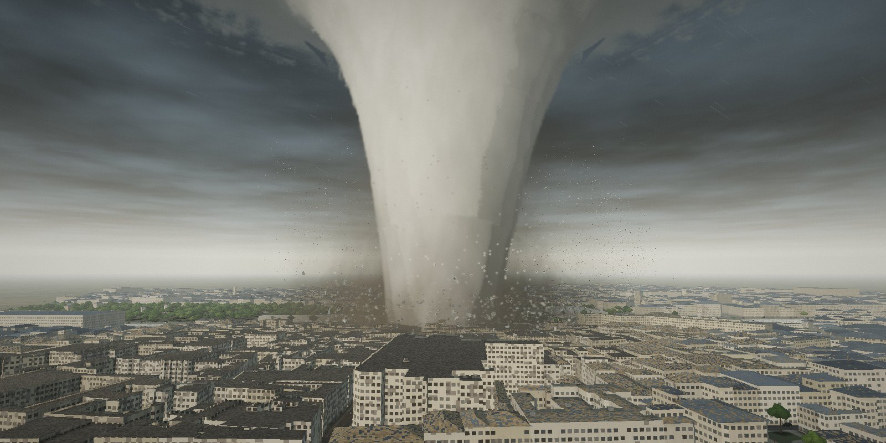

# Vortex Lab

**A real-time 3D tornado simulator that runs in the browser.**

Pick a real city, choose a tornado, set the atmosphere, then watch the storm cross the map and survey what it leaves behind.

[](LICENSE)
[](https://www.typescriptlang.org/)
[](https://threejs.org/)
[](https://vite.dev/)
[](https://www.khronos.org/webgl/)
[](https://www.openstreetmap.org/copyright)
[](https://github.com/lauroguedes/vortex-lab/commits/main)
[](#contributing)

[Features](#features) · [Screenshots](#screenshots) · [Quick start](#quick-start) · [Controls](#controls) · [How it works](#how-it-works) · [Cities](#cities) · [Sound](#sound) · [Limitations](#limitations)

</div>

---

> [!NOTE]
> Vortex Lab is an educational visualisation. It is not a forecasting, engineering or safety tool, and nothing in it is guidance on what to do in a real tornado.

## Features

- **Six real cities at 1:1 scale.** New York, London, Paris, Rome, Tokyo and Rio de Janeiro, built from OpenStreetMap footprints, heights, streets, water and parks, each with its own building materials.
- **Five tornado types.** Rope, cone, stovepipe, wedge and multi-vortex, with sliders for wind speed, core diameter, forward speed, heading, track offset and cloud-base height.
- **A funnel that comes from the physics.** There is no funnel mesh: cloud condenses wherever the vortex's pressure drop reaches saturation, so shape and touchdown follow from the settings.
- **Enhanced Fujita damage.** Every building steps through the damage ladder for its construction class, and the final EF rating comes from the worst damage found, as in a real survey.
- **Thousands of flying objects.** Shingles, lumber and sheet metal, plus cars, buses, furniture, roof sections, fences, street signs and whole tree crowns, each with its own mass and drag.
- **A living city.** About 800 vehicles drive the real street network; police, ambulances and fire engines respond as damage is reported; power lines arc and street lights go dark.
- **First-person mode.** Stand in the path and find out what the wind does to a 75 kg body.
- **Weather and light.** Rain, frequent lightning with ground strikes, four lighting presets including night, wet-road reflections, ambient occlusion and bloom.
- **Positional sound.** 31 generated sound effects mixed by the physics: distance to the vortex, wind at your position, individual structural failures, moving sirens.

## Screenshots

| | |
| :---: | :---: |
| 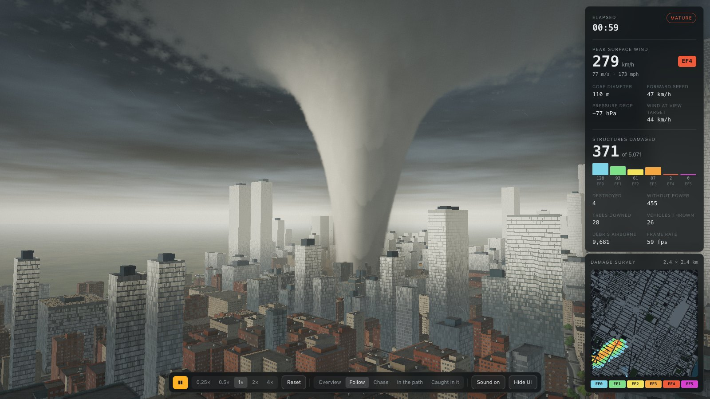 | 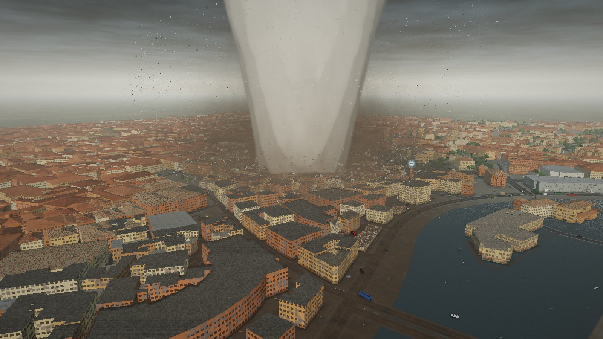 |
| **Live run.** Wind, pressure drop and a damage tally by EF rating, with the survey map filling in below. | **Damage swath.** Roofs stripped and blocks opened up behind a stovepipe crossing Rome. |
| 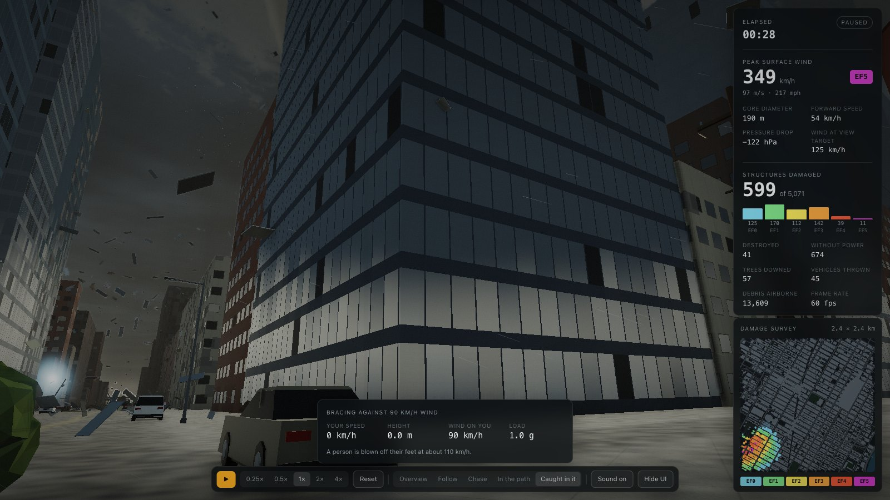 | 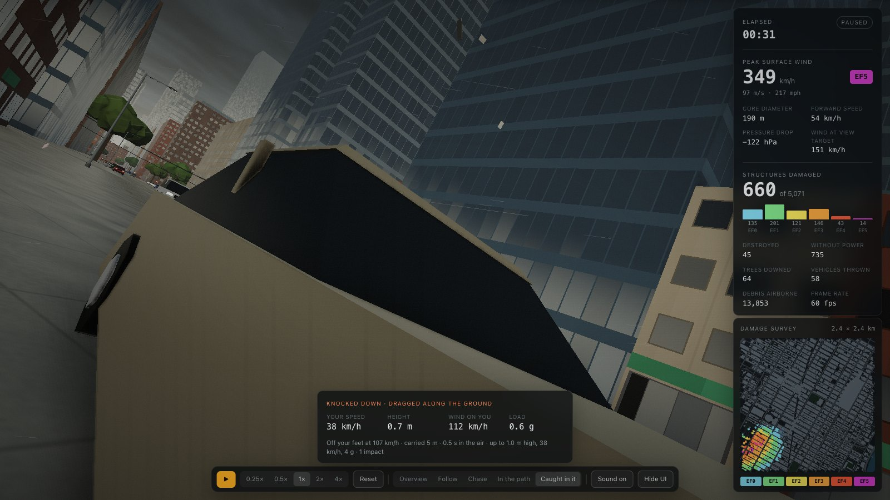 |
| **First person: bracing.** On foot where the core will pass, as the wind climbs toward 110 km/h. | **First person: off your feet.** The body is rolled, dragged or thrown by the same physics as the debris. |
| 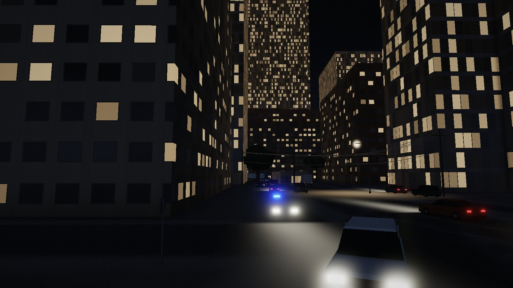 | 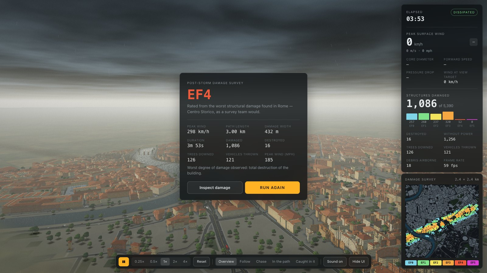 |
| **Night.** Headlights, lit windows and street lamps that fail as the power goes. | **Post-storm survey.** EF rating, path length and width, structures damaged and destroyed. |

## Quick start

**Requirements:** Node.js 20.19+ or 22.12+ (developed on Node 26) and a browser with WebGL 2.

```bash
git clone https://github.com/lauroguedes/vortex-lab.git
cd vortex-lab
npm install
npm run dev
```

Then open <http://localhost:5173>. The map tiles and sound effects are included in the repository, so no API keys are needed to run it.

```bash
npm run build      # type-check and write a production bundle to dist/
npm run preview    # serve that bundle locally
```

## Controls

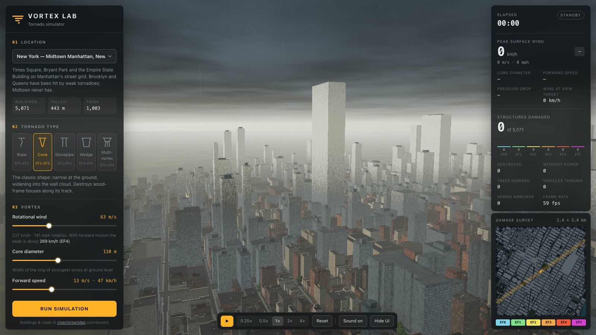

**Setup panel (left).** Choose the city and tornado type, then tune the vortex, track, atmosphere and detail. Press **Run simulation** to start; settings are locked while the storm is running.

**Readout and survey map (right).** Live wind, pressure and damage figures. During setup, click the map to aim the track.

**Toolbar (bottom).** Play / pause, simulation speed, reset, camera mode, sound and hide interface.

### Keyboard and mouse

| Input | Action |
| --- | --- |
| Left drag | Orbit the camera |
| Right drag | Pan |
| Mouse wheel | Zoom |
| <kbd>Space</kbd> | Run / pause |
| <kbd>R</kbd> | Reset |
| <kbd>1</kbd> – <kbd>5</kbd> | Camera mode (see below) |
| <kbd>H</kbd> | Hide or show the interface |
| <kbd>M</kbd> | Sound on / off |

### Camera modes

| Key | Mode | View |
| --- | --- | --- |
| <kbd>1</kbd> | Overview | The whole tile from the side of the track |
| <kbd>2</kbd> | Follow | Travels with the tornado at a distance |
| <kbd>3</kbd> | Chase | Street level, behind the tornado |
| <kbd>4</kbd> | In the path | Street level, directly ahead of it |
| <kbd>5</kbd> | Caught in it | First person, on foot where the core will pass |

### Settings

| Group | Setting | Range |
| --- | --- | --- |
| Vortex | Rotational wind | 25 – 135 m/s |
| | Core diameter | 20 – 1000 m |
| | Forward speed | 3 – 30 m/s |
| Track | Heading | 0 – 355° |
| | Track offset | ±1000 m (or click the survey map) |
| Atmosphere | Cloud-base height | 250 – 1600 m |
| | Rain | 0 – 100 % |
| | Light | Afternoon, golden hour, green dusk, night |
| | Lightning | On / off |
| Detail | Debris, volumetrics | Low, medium, high |

## How it works

Everything is in SI units at 1:1 scale: one world unit is one metre.

**Stack.** [Three.js](https://threejs.org/) (WebGL 2), TypeScript and Vite, with no other runtime dependencies. Physics runs on the CPU in typed arrays with fixed sub-steps; rendering is GPU-instanced. The frame pipeline is an HDR scene pass, a ray-marched volumetric pass for the funnel, wall cloud and dust, screen-space ambient occlusion, bloom, then an ACES tone-mapped composite.

| Part | Model | Source |
| --- | --- | --- |
| **Wind field** | Smoothed modified-Rankine tangential profile (solid-body core, `r^-α` decay, far-field taper), boundary-layer inflow, one- or two-cell updraft, translation, optional orbiting sub-vortices. | [`tornado.ts`](src/physics/tornado.ts) |
| **Pressure** | Cyclostrophic balance `∂p/∂r = ρV²/r`, integrated numerically from the wind profile. | [`tornado.ts`](src/physics/tornado.ts) |
| **Funnel** | The shader condenses cloud wherever the pressure drop exceeds the hydrostatic difference to the cloud base (`y + Δp/ρg > LCL`). A weak tornado under a high cloud base shows a funnel aloft and only a debris whirl on the ground. | [`pipeline.ts`](src/render/pipeline.ts) |
| **Damage** | Enhanced Fujita Damage Indicators and Degrees of Damage for houses, low-, mid- and high-rise buildings, metal buildings and hardwood trees. Each structure tracks its peak gust. | [`damage.ts`](src/physics/damage.ts) |
| **Debris and objects** | Each piece has a ballistic coefficient `b = ρ·Cd·A / 2m` and is integrated with quadratic drag, gravity, near-ground lift, autorotation lift and turbulence. Vehicles are bluff bodies: a violent vortex tosses them tens of metres, a weak one only rolls them. | [`debris.ts`](src/physics/debris.ts), [`shapes.ts`](src/world/shapes.ts) |
| **Buildings** | Pitched roofs, masonry, shopfronts, parapets, rooftop plant and reflective curtain walls. When a roof is lost you look down into the rooms (interior mapping). | [`city.ts`](src/world/city.ts) |
| **Traffic** | The mapped streets form a graph. Vehicles follow it lane by lane with the Intelligent Driver Model, slow for turns and take junctions one at a time, keeping left in London and Tokyo. Drivers flee, crawl, then stop as the wind rises; once the wind can move a vehicle the debris physics takes over. | [`traffic.ts`](src/world/traffic.ts) |
| **Streets** | Utility poles with overhead lines and street lights. Poles lean and break at the EF-scale wind speeds for their damage indicators, bringing their spans down with a power flash. | [`street.ts`](src/world/street.ts) |
| **First person** | A 75 kg adult in the same drag physics: blown off their feet when drag beats friction (about 30 m/s), then rolled, dragged or thrown, sliding along walls and landing on roofs. Vision tunnels under load and blacks out briefly on impact. | [`victim.ts`](src/world/victim.ts) |
| **Hemisphere** | Cyclonic rotation: counter-clockwise in the north, clockwise in Rio. | [`main.ts`](src/main.ts) |

### Project structure

```text
src/
  main.ts            app loop, cameras, wiring
  physics/           tornado wind field, debris, EF-scale damage
  world/             city, traffic, street furniture, props, sky, rain, first person, 3D models
  render/            lighting, volumetric funnel, ambient occlusion, bloom
  audio/             sound engine
  ui/                settings panel, readout, survey map
  data/              city list and tornado presets
scripts/             map download, sound generation, screenshot capture
public/cities/       OpenStreetMap tiles (generated)
public/audio/        sound effects (generated)
docs/images/         README images (generated)
```

### Scripts

| Command | What it does |
| --- | --- |
| `npm run dev` | Start the development server on port 5173 |
| `npm run build` | Type-check and build the production bundle |
| `npm run preview` | Serve the production bundle |
| `npm run typecheck` | Type-check only |
| `npm run fetch-cities` | Download the city tiles from OpenStreetMap (Overpass API) |
| `npm run generate-sounds` | Generate the sound effects with ElevenLabs (needs an API key) |
| `npm run screenshots` | Recapture the README images with headless Chrome (needs `npm run dev` running) |

## Cities

Each tile is 2.4 × 2.4 km of real map data. Where OpenStreetMap has no height for a building, a typical number of storeys for that city is assumed.

| | | |
| :---: | :---: | :---: |
| 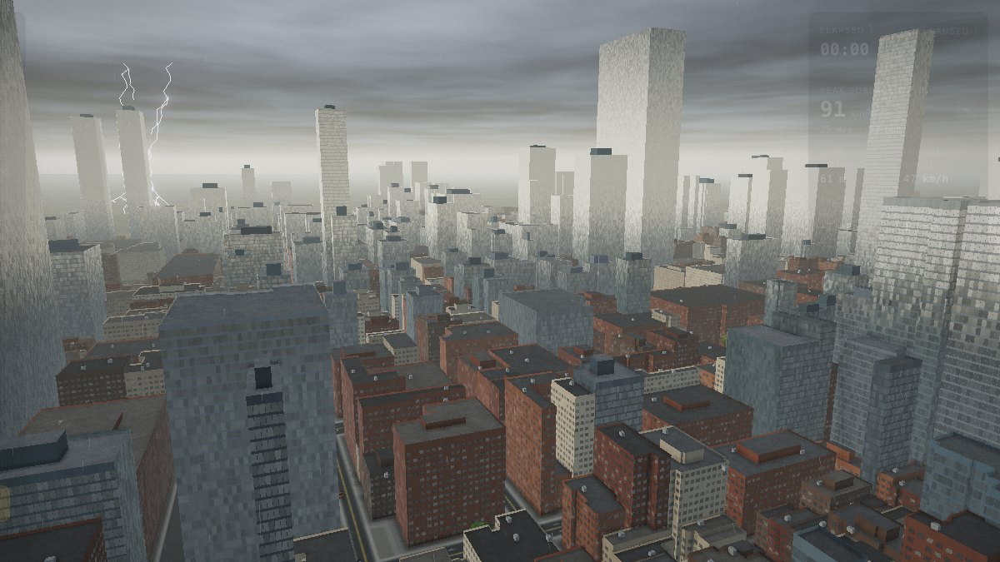 | 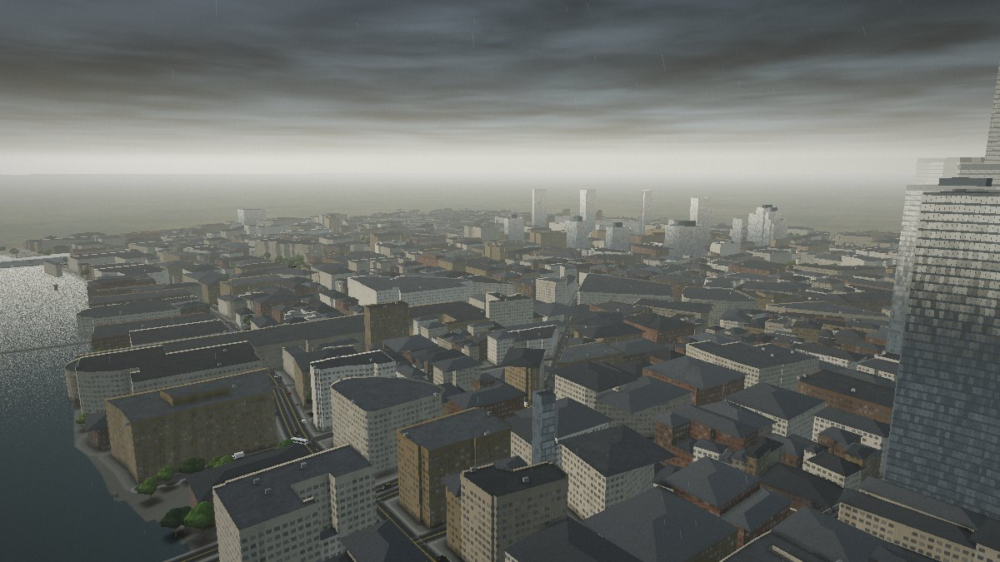 | 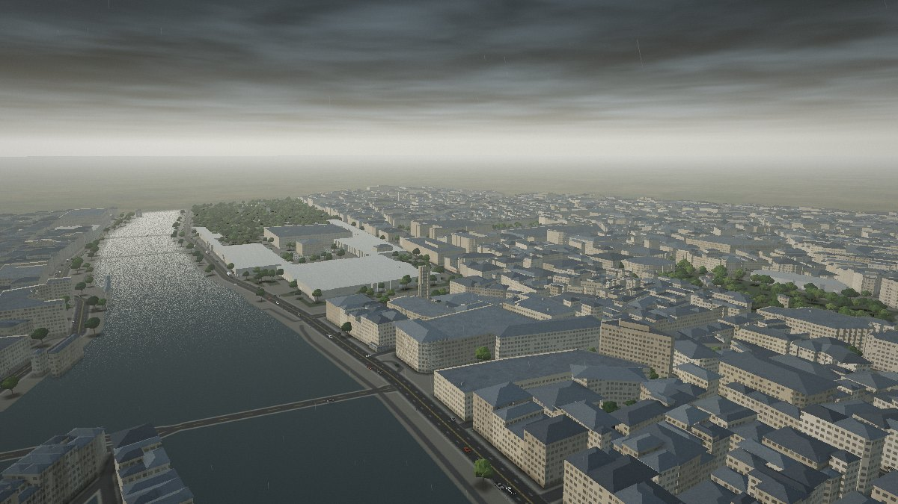 |
| **New York** · Midtown Manhattan<br>5,071 buildings | **London** · The City and the Thames<br>4,409 buildings | **Paris** · Louvre to Île de la Cité<br>8,013 buildings |
| 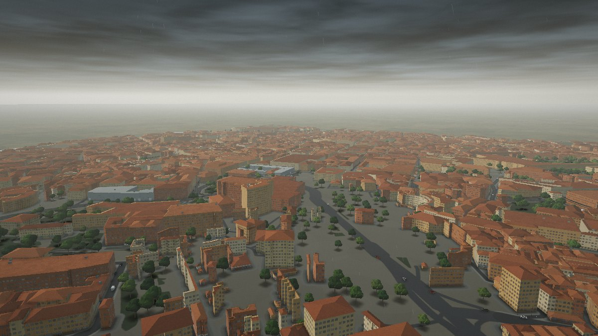 | 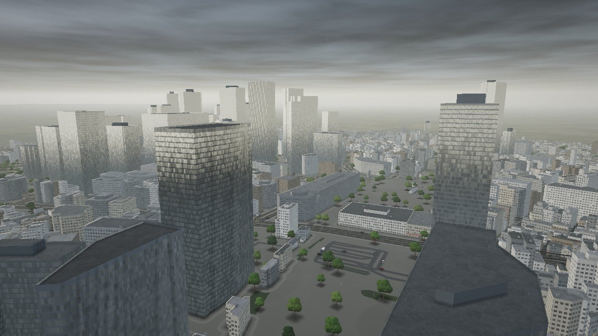 | 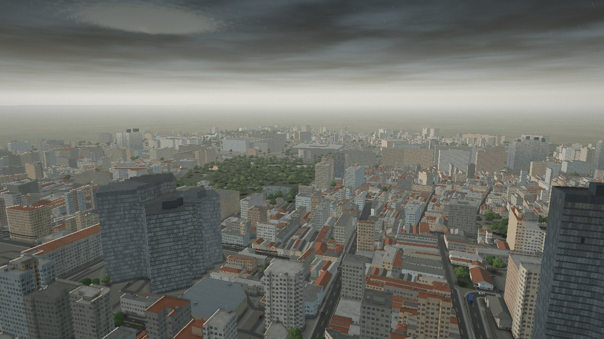 |
| **Rome** · Centro Storico<br>5,390 buildings | **Tokyo** · Shinjuku<br>11,769 buildings | **Rio de Janeiro** · Centro<br>12,046 buildings |

### Adding a city

Add an entry to [`src/data/cities.json`](src/data/cities.json) with an `id`, a `name` and the latitude and longitude of the tile centre, then run:

```bash
npm run fetch-cities -- <id>
```

Optional keys: `style` (material palette), `levels` (storeys assumed where the map has no height), `urban` (paved rather than grassed open ground), `pitched` (roofs on city blocks), `left` (left-hand traffic) and `infill` (line residential streets with houses where few buildings are mapped).

## Sound

The audio engine mixes looping layers (distant and close tornado roar, wind, rain, debris, warning siren), the moving sirens of the nearest police car, ambulance and fire engine, and positioned one-shots (thunder, collapse, glass, sheet metal, vehicle impacts, car horns, transformer arcs, falling trees). Each one-shot is delayed by its travel time at 343 m/s, panned, and dulled with distance. Sound switches on with the first run.

The 31 clips in [`public/audio/`](public/audio) were generated with the [ElevenLabs sound-effects API](https://elevenlabs.io/docs/api-reference/text-to-sound-effects/convert). To regenerate them:

```bash
echo 'ELEVEN_LABS_API_KEY=sk_...' > .env    # the secret key, not the key ID
npm run generate-sounds
```

The script skips clips that already exist. Use `--force` to regenerate, `--only=siren,glass` to limit it, or `--dry` to list the work. The key is read by that script only and never reaches the browser. Without the clips, the engine falls back to synthesised wind and thunder.

## Performance

Measured on an Apple M1 at 2048 × 1536: about 13 ms per frame for a typical run, and about 22 ms in the heaviest case tested (Tokyo with an EF5 wedge). Physics takes 3 – 6 ms per step. The render resolution drops automatically if the frame rate stays below 40 fps, and the **Detail** settings trade debris count and volumetric quality for speed.

## Limitations

- **The vortex is prescribed, not solved.** The wind field does not react to buildings or terrain.
- **Terrain is flat**, including Rio's hills, and there is no coastline.
- **Collisions are limited.** Debris and traffic pass through structures; only the first-person body collides with buildings.
- **Traffic is simplified.** It ignores one-way streets and traffic signals.
- **Damage thresholds are approximate.** They follow the EF-scale expected values with ±15 % random construction quality, and were not checked line by line against the published tables.
- **Tornadoes of this strength are not expected in all of these cities.** The scenarios are what-ifs.

## Contributing

Issues and pull requests are welcome. For anything larger than a small fix, please open an issue first to discuss the change. Before submitting, run:

```bash
npm run build
```

If your change alters how the app looks, recapture the README images with `npm run screenshots`.

## License and credits

- **Code:** [MIT](LICENSE).
- **Map data:** © [OpenStreetMap](https://www.openstreetmap.org/copyright) contributors, available under the [Open Database License](https://opendatacommons.org/licenses/odbl/). The tiles in `public/cities/` are derived from it and remain under that licence.
- **Sound effects:** generated with [ElevenLabs](https://elevenlabs.io/); their use is subject to ElevenLabs' terms.
- **Rendering:** [Three.js](https://threejs.org/) (MIT).
